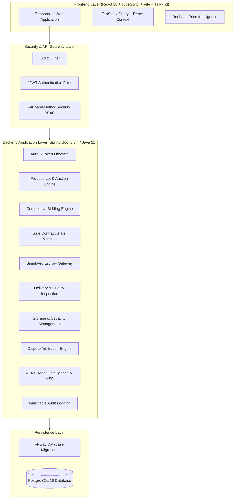
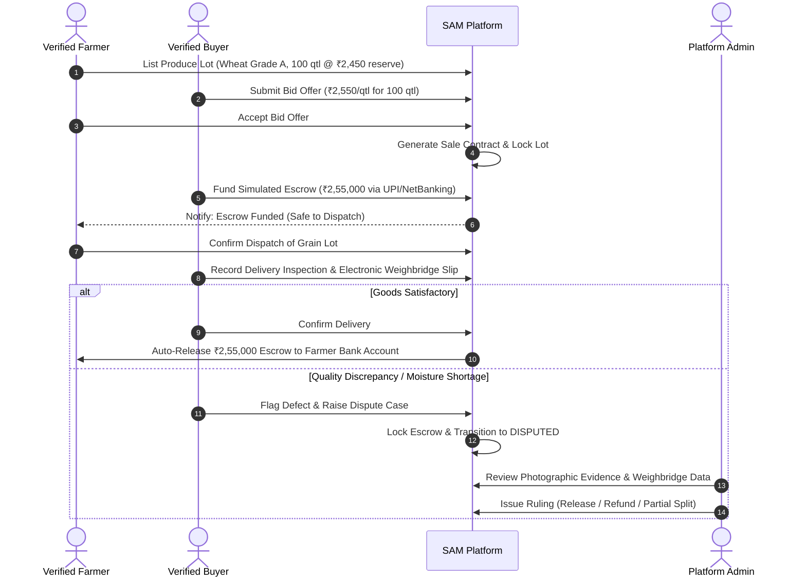
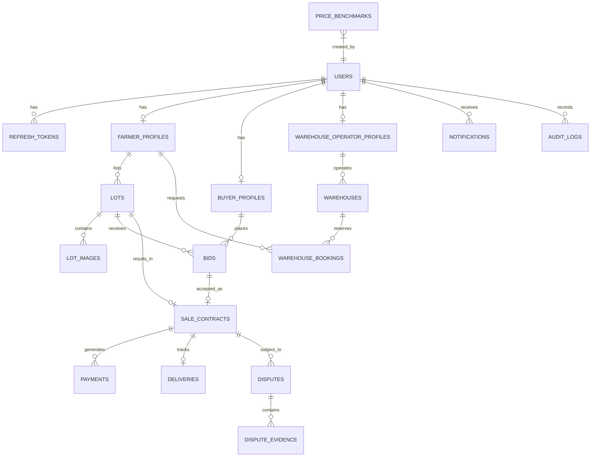

# Smart Agricultural Marketplace (SAM) 🌾

[](https://spring.io/projects/spring-boot)
[](https://openjdk.org/)
[](https://react.dev/)
[](https://www.typescriptlang.org/)
[](https://vitejs.dev/)
[](https://tailwindcss.com/)
[](https://www.postgresql.org/)
[]()

> **Academic SRS Prototype**: A full-stack agricultural e-commerce & auction marketplace connecting verified Indian farmers with verified commercial buyers. Features digital produce auctions, Haryana APMC Mandi price benchmarks, simulated escrow payment workflows, delivery inspection, WDRA-accredited warehouse reservations, and administrative dispute adjudication.

---

## 🏛️ System Architecture



---

## 📦 Key Technology Stack

### Backend
- **Java 21 (LTS)** & **Spring Boot 3.3.4**
- **Spring Web** (RESTful APIs with standard HTTP status codes)
- **Spring Data JPA & Hibernate** (Optimized relationships and queries)
- **Spring Security 6** with stateless **JJWT (0.12.6)** access & refresh tokens
- **PostgreSQL 16** with **Flyway** schema migrations
- **Jakarta Bean Validation** (Server-side validation)
- **OpenAPI 3 / Swagger UI** (`/swagger-ui/index.html`)
- **JUnit 5 & Mockito** (100% test pass rate)
- Clean POJO / DTO pattern with SLF4J logging

### Frontend
- **React 18** with **TypeScript** & **Vite**
- **Tailwind CSS** with responsive mobile/tablet/desktop layouts
- **React Router v6** (Role-protected dashboard routes)
- **TanStack React Query** & **Axios** (With automatic 401 JWT refresh token rotation)
- **Recharts** (30-day interactive Mandi historical price trend area charts)
- **Lucide React** icons & **Dual-Language Context** (English & Hindi)

### Infrastructure & DevOps
- **Docker** & **Docker Compose** (PostgreSQL + Spring Boot API + React Nginx)
- Multi-stage Docker builds for minimal container footprints

---

## 👥 User Roles & Access Control

| Role | Permissions & Core Capabilities |
| :--- | :--- |
| **`FARMER`** | List produce lots (Wheat, Paddy, Mustard), view incoming buyer bids ranked by price, accept bids to auto-generate sale contracts, confirm dispatch, track bank escrow releases, book warehouse storage slots. |
| **`BUYER`** | Browse open produce lots with APMC price comparisons, place competitive bids, fund simulated escrow (UPI, NetBanking, Bank Transfer), inspect deliveries, flag quality deviations, raise disputes. |
| **`WAREHOUSE_OPERATOR`** | Register storage facilities, set monthly storage charges per quintal, manage capacity occupancy, review and approve farmer storage reservations. |
| **`ADMIN`** | Verify new user registrations (KYC approval), suspend/reactivate accounts, arbitrate escrow disputes (Release to Farmer, Refund Buyer, Partial Split), publish Mandi APMC benchmark prices and MSPs, audit system access trails. |

---

## 🔄 End-to-End Business Lifecycle



---

## 🌾 Haryana APMC Mandi Benchmark Integration

SAM is pre-seeded with APMC Mandi market intelligence across **6 Haryana agricultural districts**:
- **Karnal** (Major Basmati & Wheat Mandi)
- **Hisar** (Key Mustard & Grain Trading Hub)
- **Ambala** (Northern Haryana Market Center)
- **Rohtak** (Central Haryana Trading Depot)
- **Sirsa** (Western Wheat & Cotton Belt)
- **Panipat** (Textile & Grain Logistics Hub)

### Features:
1. **Interactive 30-Day Trends**: Modal, minimum, and maximum price curves rendered using Recharts.
2. **MSP Reference Ceiling**: Official Cabinet Committee on Economic Affairs (CCEA) price floors.
3. **Fair Value Calculator**: Lower bound, suggested target, and upper bound trade recommendations.

---

## 🔑 Demo Seed Accounts

The platform includes pre-configured demo accounts for immediate testing:

| Role | Mobile Number | Password | Account Status | Notes |
| :--- | :--- | :--- | :--- | :--- |
| **Admin** | `9000000001` | `Admin@123` | `ACTIVE` | Full platform arbitrator & KYC manager |
| **Farmer** | `9000000002` | `Farmer@123` | `ACTIVE` | Taraori, Karnal (Has listed wheat & paddy lots) |
| **Buyer** | `9000000003` | `Buyer@123` | `ACTIVE` | Haryana Agro Millers Ltd (Verified Trader) |
| **Warehouse Operator** | `9000000004` | `Warehouse@123` | `ACTIVE` | WDRA Accredited Cold/Dry Storage Manager |

> **Development Mode Mock OTP**: `123456` (Pre-filled on OTP verification screens).

---

## 🗄️ Database Schema & Entities

The PostgreSQL schema (`V1__init_schema.sql` and `V2__seed_initial_data.sql`) comprises **19 normalized tables**:



---

## 🚀 Quickstart Guide

### Option 1: Run with Docker Compose (Recommended)

Ensure Docker Desktop is running, then execute:

```bash
# Clone and navigate to workspace
cd sam-marketplace

# Start PostgreSQL, Backend API, and Frontend SPA
docker-compose up --build
```

- **Frontend Application**: `http://localhost`
- **Backend API**: `http://localhost:8080/api`
- **Swagger / OpenAPI Documentation**: `http://localhost:8080/swagger-ui/index.html`

---

### Option 2: Run Locally (Maven + Node.js)

#### 1. Start PostgreSQL
Make sure PostgreSQL is running on `localhost:5432` with database `sam_marketplace`, username `sam_user`, and password `sam_password` (or adjust `backend/src/main/resources/application-dev.yml`).

#### 2. Start Spring Boot Backend
```bash
cd backend
mvn clean spring-boot:run
```
Backend will start on port `8080` and seed all demo data automatically.

#### 3. Start React Frontend
```bash
cd frontend
npm install
npm run dev
```
Frontend will start on `http://localhost:5173` (proxied to port 8080).

---

## 🧪 Running Automated Tests

```bash
cd backend
mvn test
```
All unit and slice tests execute against the H2 in-memory profile with Mockito and JUnit 5.

---

## ⚠️ Academic Prototype Disclaimer
This application is an educational MVP built to demonstrate the Software Requirements Specification (SRS) for digital agricultural marketplaces. Payment processing, SMS gateway integrations, and bank APIs are **simulated in sandbox mode** with zero real financial debits.
